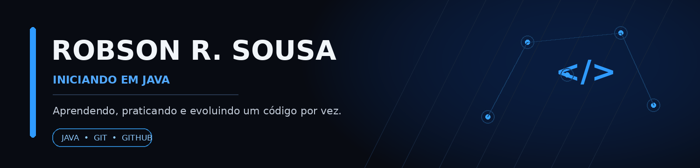

 

# Olá! Eu sou o Robson 👋

### Desenvolvedor em formação | Iniciando minha jornada com Java

Estou construindo minha base em programação, aprendendo Java e desenvolvendo meus conhecimentos passo a passo. Uso este perfil para registrar minha evolução, praticar boas práticas e compartilhar meus estudos.

---

## 👨‍💻 Sobre mim

- 🌱 Atualmente, estou iniciando meus estudos em **Java**.
- 📚 Aprendendo lógica de programação, orientação a objetos e fundamentos do desenvolvimento.
- 🧩 Praticando resolução de problemas e construindo pequenos exercícios para consolidar o aprendizado.
- 🔧 Conhecendo ferramentas como Git e GitHub para organizar e versionar meus estudos.
- 🎯 Meu objetivo é evoluir com consistência e, com o tempo, desenvolver projetos cada vez mais completos.

> Estou no começo da jornada e acredito que cada exercício, erro corrigido e conceito aprendido faz parte da construção de uma boa base técnica.

## 🛠️ Tecnologias e ferramentas

&nbsp;&nbsp;

&nbsp;&nbsp;

 

**Estudando:** Java  
**Conhecendo:** Git e GitHub

## 📘 O que estou estudando

- Fundamentos da linguagem Java
- Variáveis, tipos de dados e operadores
- Estruturas condicionais e de repetição
- Métodos e organização do código
- Orientação a objetos: classes, objetos, encapsulamento e herança
- Git e GitHub para controle de versão

*Esta lista representa minha trilha de estudos e será atualizada conforme eu avançar.*

## 🚧 Meu progresso

Este perfil está em construção, assim como minha experiência com programação. No momento, meu foco é aprender os fundamentos e registrar exercícios e pequenos projetos de estudo à medida que estiverem prontos.

Quando eu publicar projetos, pretendo incluir em cada repositório:

- Qual problema o código resolve.
- Quais conceitos pratiquei.
- Como executar o programa.
- O que aprendi e o que pretendo melhorar.

## 📊 Minha atividade no GitHub

 

## 📫 Contato

- GitHub: [@robsonds25](https://github.com/robsonds25)
- LinkedIn: www.linkedin.com/in/robson-ribeiro-b9b553227

---

  Aprendendo um pouco todos os dias. O importante é continuar evoluindo. 🚀

